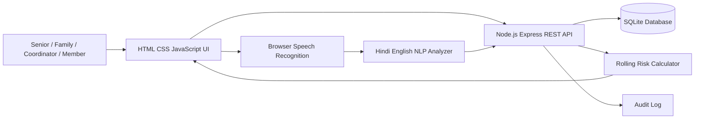

# Samarth Early Warning Architecture

## System overview

## Backend ownership

### Harsh — Backend and Database

- Node.js and Express server setup
- REST routes for seniors, check-ins, follow-ups, members, feedback, authentication, operations and risk
- SQLite schema, indexes, seed data and persistence
- Request validation, JSON parsing, status codes, not-found handling and audit logging

### Gauri — Core Logic and Testing

- Personal-baseline risk calculation from rolling trend values, deviation and changed-signal contribution
- Synthetic sample dataset and risk scenarios
- Result validation, invalid-input cases and missing-resource tests
- Architecture documentation and API run instructions

## API and data flow

1. The browser loads senior records from `GET /api/seniors`.
2. The coordinator selects a priority and submits follow-up or feedback events.
3. Senior and member screens submit check-ins and health updates through `POST` APIs.
4. Express validates requests, writes SQLite records and records audit events.
5. Dashboard and operations endpoints derive summary counts from database records.

## Core risk logic

The prototype combines a seven-day trend deviation score with the count of changed personal-baseline signals. The result is capped from 0 to 100.

- High: 70–100
- Medium: 45–69
- Low: 0–44

The score is decision support only. A care coordinator makes the final human decision; this system does not diagnose or prescribe treatment.

## Loading and failure handling

- Loading banners appear while API requests are running.
- Success banners confirm persisted updates.
- Error banners display API or network failures with retry.
- Static sample data remains available if the backend cannot be reached.
- API errors return JSON with an `error` field and the appropriate HTTP status.

## Voice and NLP

- The browser Web Speech API records speech and converts Hindi or English audio to editable text.
- Recording requires microphone permission and works in browsers that support SpeechRecognition.
- The Express `/api/nlp/analyze` endpoint applies explainable keyword, negation and urgent-signal rules.
- Member notes are analyzed when submitted and the result is stored with the SQLite member record.
- Voice health chat asks sequential spoken questions, captures Hindi or English speech, stores transcripts as member notes and submits the update after the conversation.

## Vitals and explainable risk

- Vitals can be entered manually or supplied by connected devices through `POST /api/vitals`.
- Reading history is persisted per senior and available through `GET /api/vitals/:seniorId`.
- Risk scoring combines personal-trend deviation, median absolute deviation, recent persistence, weighted changed signals and plain-language contributions.
